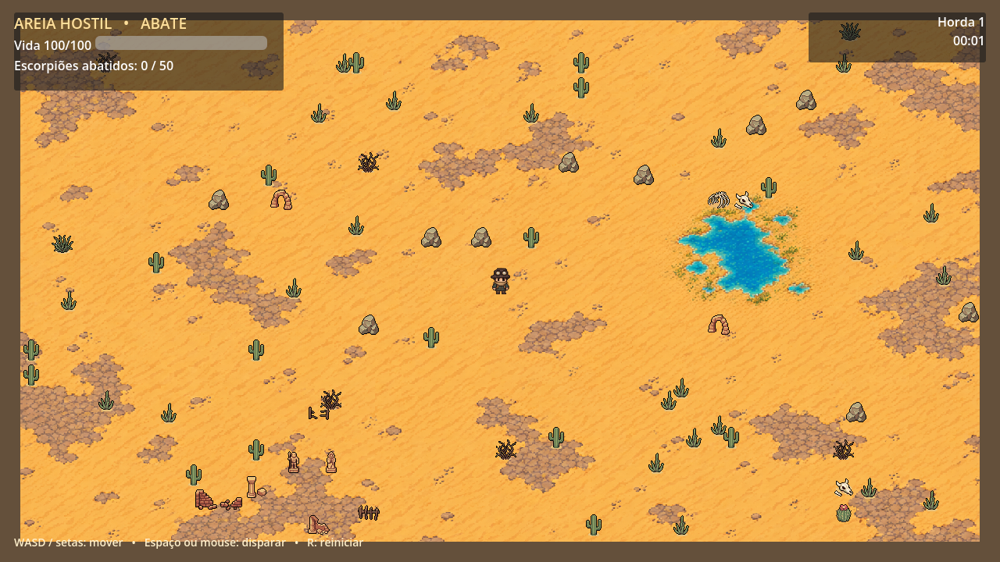

# Areia Hostil: Abate

Jogo 2D de arena vista de cima, criado por Enzo Rafael para Jogos Digitais II.

## Carta do projeto

- Tema: deserto com escorpiões de areia.
- Tipo: Abate — vencer ao derrotar 50 inimigos.
- Modo: horda em arena vista de cima.

## Como jogar

- Mova-se com **WASD** ou as **setas**.
- Mire com o mouse e segure o **botão esquerdo** ou **Espaço** para disparar.
- Sobreviva à horda e derrote **50 escorpiões**. Kits médicos podem restaurar vida.
- Ao terminar, use **R** ou o botão na tela para reiniciar.

O projeto contém a arena editável no Godot, explorador animado em quatro direções, escorpiões com estados de movimento e dano, dardos de areia incandescente, itens de cura, horda progressiva, HUD e finais de vitória e derrota. As animações do explorador são montadas em oito sequências de quatro quadros no recurso SpriteFrames da cena, para edição no painel de animações do Godot.

## Organização

- `scenes/main.tscn`: mapa e arena editáveis.
- `entities/`: cenas independentes do jogador, inimigos, projéteis e itens.
- `scripts/`: lógica e máquinas de estado do jogo.
- `assets/custom/`: sprites pixel art e ícones feitos para o projeto.

## Créditos e uso de IA

Os scripts de gameplay e o teste automatizado foram desenvolvidos com auxílio do OpenAI Codex; cada arquivo GDScript identifica essa origem no comentário inicial. O projeto foi revisado e testado no Godot pelo responsável.

O explorador, o escorpião, o mapa do oásis e a folha de obstáculos são criações geradas para este jogo no PixelLab Creator, conforme registrado no `DEVLOG.md`. Os termos do PixelLab dizem que o usuário mantém os direitos autorais de suas criações e vinculam o uso à licença Open RAIL-M. Consulte [termos do PixelLab](https://www.pixellab.ai/termsofservice) e [Open RAIL-M](https://www.licenses.ai/ai-pubs-open-railm).

O Codex também ajudou a identificar e registrar a origem e a licença dos recursos selecionados do **Desert Shooter Pack**, de Kenney. Essas imagens são do pacote de Kenney, não foram geradas pelo Codex; a licença CC0 e as fontes estão em `assets/kenney_desert_shooter/LICENSE.txt`. Os nomes das pastas antigas não alteram a origem indicada para cada arquivo em `assets/custom/ORIGEM.md`.

## Captura de tela

